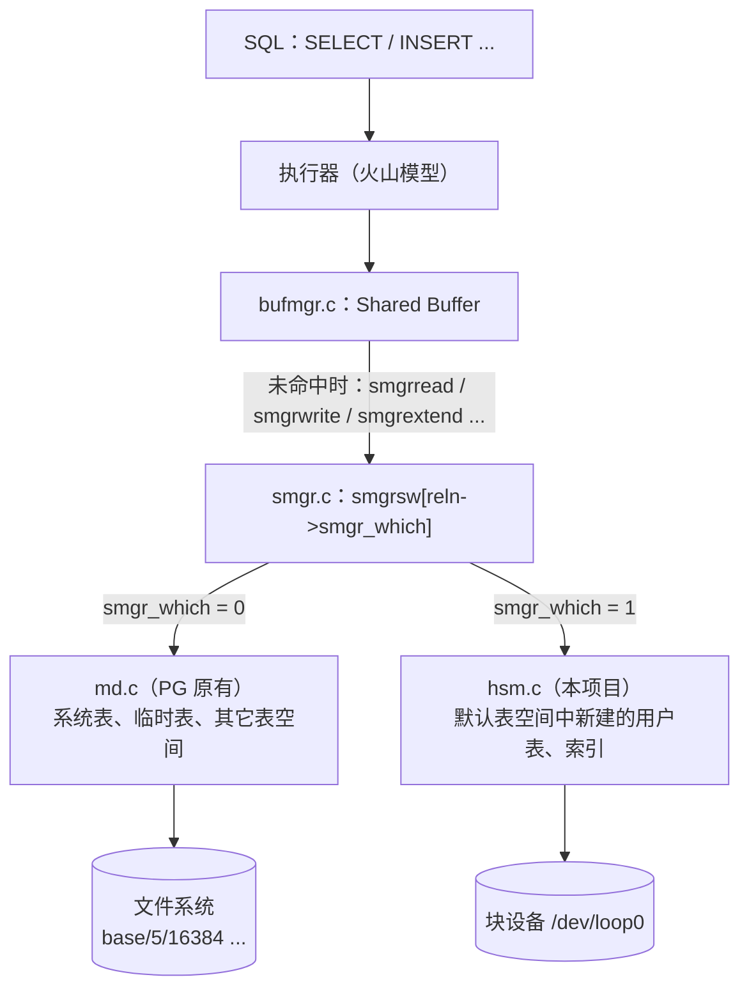

# 大作业二：PostgreSQL 15 块设备存储引擎 HSM

> 本分支在 PostgreSQL 15（REL_15_STABLE）中新增了一个存储引擎 **HSM**：表和索引的数据**不再存成文件**，
> 而是直接存放在本地块设备（如 `/dev/loop0`）上，由 HSM 自己负责空间分配、回收和元数据检索。

| | |
|---|---|
| 实现的接口 | `f_smgr` 全部 15 个（题目要求的 `init / open / create / read / write / close` 之外，`exists / extend / nblocks / truncate / unlink / prefetch / writeback / immedsync / shutdown` 也都实现了，否则连 `CREATE TABLE` 都跑不通） |
| 主要代码 | [`src/backend/storage/smgr/hsm.c`](https://github.com/bin1231231/postgres/blob/hsm-smgr/src/backend/storage/smgr/hsm.c)（约 2200 行，含注释）、[`hsm.h`](https://github.com/bin1231231/postgres/blob/hsm-smgr/src/include/storage/hsm.h) |
| 测试 | 启用 HSM 时 PG 自带回归测试 **221/221** 通过；HSM 专项 TAP 测试 **33/33** 通过；pgbench 压力下强制停机 3 次，数据一致 |
| 一键演示 | `docker build -t pg-hsm -f hsm-docker/Dockerfile . && docker run -it --rm --privileged pg-hsm` |

**目录**：
[1 运行效果](#1-运行效果) ·
[2 在 PG 中的位置](#2-hsm-在-postgresql-中的位置) ·
[3 设备上的数据组织](#3-设备上的数据怎么组织空间元数据) ·
[4 元数据检索](#4-元数据怎么检索块号--设备位置) ·
[5 一次读写的路径](#5-一次读写走过的路径gdb-实测) ·
[6 接口实现](#6-15-个接口分别做了什么) ·
[7 崩溃一致性](#7-崩溃一致性4-条规则) ·
[8 改动的文件](#8-改动了-pg-的哪些地方) ·
[9 验证](#9-怎么验证) ·
[10 与 PPT 设计的对比](#10-与-ppt-中-hsm-设计的对比和已知限制)

---

## 1. 运行效果

用 PPT 里的 `vage` 表演示（以下是 Docker 中的实际输出）：

```text
>> HSM 设备: /dev/loop0
LOG:  formatted HSM device "/dev/loop0": 131072 blocks, 4096 file slots, 16351 extent units of 64 kB

postgres=# CREATE TABLE vage (id1 int, c1 varchar(30), id2 int, c2 varchar(30));
postgres=# INSERT INTO vage SELECT generate_series(1,5), 'AAAAAAAA'||generate_series(1,5), ...;
postgres=# SELECT relname, relfilenode, pg_relation_filepath(oid) FROM pg_class WHERE relname = 'vage';
 relname | relfilenode | pg_relation_filepath
---------+-------------+----------------------
 vage    |       16384 | base/5/16384          ← 这个文件并不存在

>> 绕过数据库，直接用 dd 读块设备 /dev/loop0 的第 264 块（页尾就是元组）：
0008160 001  \0  \0  \0 025   A   A   A   A   A   A   A   A   1  \0  \0
0008176   e  \0  \0  \0 025   a   a   a   a   a   a   a   a   1  \0  \0
                                                    ↑ c1='AAAAAAAA1'，e = 0x65 = 101 = id2
```

用三个 SQL 函数可以直接看到存储引擎内部的元数据：

```sql
SELECT * FROM pg_hsm_status();    -- 设备大小、已用/空闲空间、I/O 统计
SELECT * FROM pg_hsm_files();     -- 文件表：每个表/索引 fork 一行
SELECT * FROM pg_hsm_extents();   -- 区表：每个区一行（对应 PPT 中的 FILE_ID / Extent_ID 表）
```

---

## 2. HSM 在 PostgreSQL 中的位置



- **接入点就是 PPT 讲的 `smgrsw[]`**：在 [`smgr.c` 第 87 行](https://github.com/bin1231231/postgres/blob/hsm-smgr/src/backend/storage/smgr/smgr.c#L87) 增加第 2 个 `f_smgr` 元素，15 个函数指针全部指向 `hsm_*`。
- **路由**：`smgropen()` 原来写死 `reln->smgr_which = 0`，改为调用
  [`hsm_choose_smgr()`](https://github.com/bin1231231/postgres/blob/hsm-smgr/src/backend/storage/smgr/hsm.c#L1077)，每个关系只判断一次，结果缓存在 `SMgrRelation` 中：

  | 关系 | 交给 |
  |---|---|
  | `hsm_device` 为空（默认） | 全部 md.c，行为与原版 PG 完全相同 |
  | 系统表（relfilenode < 16384，initdb 创建）、临时表、非默认表空间 | md.c |
  | 已经在 HSM 文件表中的 relfilenode | HSM |
  | 启用 HSM 之前就存在、已有 md 文件的用户表 | md.c（不影响老数据） |
  | 其余：新建的用户表、索引、TOAST 表及其 FSM/VM | **HSM** |

- 打开方式只有一行配置：`hsm_device = '/dev/loop0'`。全零的新设备在第一次启动时自动格式化。

---

## 3. 设备上的数据怎么组织（空间元数据）

存储引擎的核心是**空间元数据的管理与检索**（PPT《存储引擎设计》）。HSM 把设备分成三段（块大小 = 8KB）：

```text
设备块号  0           1 ............ 256  257..263   264 .................................. 131071
        ┌───────────┬──────────────────────────────┬────────────────────────────────────────┐
        │ 超级块     │ 文件表                        │ 数据区                                  │
        │ 魔数 HSM1  │ 4096 条记录 × 512 字节        │ 16351 个 64KB 的“分配单元”                │
        │ 布局 + CRC │ 每个表/索引 fork 一条          │ 以“区”为单位分配，以“块”为单位使用         │
        └───────────┴──────────────────────────────┴────────────────────────────────────────┘
        （1GB 设备时的实际数值；对齐到 8 块后数据区从第 264 块开始）
```

**文件表记录**（[`HsmDiskRecord`](https://github.com/bin1231231/postgres/blob/hsm-smgr/src/backend/storage/smgr/hsm.c#L112)，恰好 512 字节 = 1 个扇区）：

| 字段 | 含义 | 对应 PPT 中的 |
|---|---|---|
| `rnode` + `forknum` | 哪个表的哪个 fork（main/fsm/vm/init） | FILE_ID |
| `nblocks` | 逻辑长度（块） | 文件大小 |
| `extents[60]` = {设备起始块, 块数} | 这个 fork 拥有的区，按顺序排列 | Extent_ID、Extent_Size、偏移 |
| `flags`、`crc` | 墓碑标记；整条记录的校验和 | 健壮性、一致性 |

**区的大小随文件增长**（PPT：“文件越大、区越大”，[`hsm_extent_target_blocks()`](https://github.com/bin1231231/postgres/blob/hsm-smgr/src/backend/storage/smgr/hsm.c#L240)）：

| 第几个区 | 0–7 | 8–15 | 16–31 | 32–39 | 40–59 |
|---|---|---|---|---|---|
| 区大小 | 64KB | 512KB | 4MB | 32MB | 64MB |

一个 4 行的小表只占 64KB；大表的区越来越大，60 个区就能容纳约 1.6GB，元数据始终只有一条记录。
空间不够连续时，区的大小逐次减半重试（[`hsm_add_extent()`](https://github.com/bin1231231/postgres/blob/hsm-smgr/src/backend/storage/smgr/hsm.c#L535)）。

**三个关键取舍**：

1. **记录 = 1 个扇区**：单条记录的写入是原子的，不会写坏相邻记录；每条记录带 CRC。
2. **空闲空间位图不落盘**：启动时由文件表重建（[`hsm_load_metadata()`](https://github.com/bin1231231/postgres/blob/hsm-smgr/src/backend/storage/smgr/hsm.c#L861)），
   避免“文件表和位图互相矛盾”；重建时检查区是否越界、是否被重复占用，发现问题就拒绝启动。
3. **元数据不用数据库表来存**：PPT 中讲过，文件层元数据的读写可能发生在数据库启动之前（例如崩溃恢复），
   所以必须自己实现“表”。HSM 的文件表就是这样一张自己实现的定长记录表。

---

## 4. 元数据怎么检索：块号 → 设备位置


- postmaster 启动时把整个文件表加载进**共享内存哈希表** `(RelFileNode, fork) → HsmFile`，所有后端共用，
  之后的查找不再读盘（相当于 PPT 中“HASH 作为 1 级缓存”）。
- **实例**：表 `big` 的第 600 块。`pg_hsm_extents()` 显示第 16 个区覆盖逻辑块 576–1087，从设备第 856 块开始，
  所以它在设备第 856 + (600 − 576) = **880** 块，字节偏移 880 × 8192 = 7208960
  （[`hsm_map_block()`](https://github.com/bin1231231/postgres/blob/hsm-smgr/src/backend/storage/smgr/hsm.c#L380)）。
- **并发**：只读/写数据块时，持 `HsmLock` **共享锁**查映射，真正的 `pread/pwrite` 在锁外完成；
  只有分配区、截断、删除时才需要排他锁。
- **只需一个设备 fd**：md.c 需要为每个 fork 维护 `MdfdVec`、vfd、1GB 分段；HSM 所有关系共用一个设备 fd，
  因此 `hsm_open / hsm_close` 是空函数。

---

## 5. 一次读写走过的路径（gdb 实测）

对应 PPT《存储引擎与接口实现原理》中“I/O 的路径”那一页，这里换成 HSM 的实际调用栈。

**读**：`SELECT count(*) FROM demo WHERE id = 7`，表的页不在 Shared Buffer 中：

```text
#0  hsm_read (forknum=MAIN_FORKNUM, blocknum=0)        hsm.c        ← 本项目
#1  smgrread                                           smgr.c:559   ← smgrsw[1].smgr_read
#2  ReadBuffer_common                                  bufmgr.c     ← Shared Buffer 未命中
#3  ReadBufferExtended
#4  heapgetpage (page=0)                               heapam.c
#8  SeqNext                                            nodeSeqscan.c
#11 ExecSeqScan                                        ← 火山模型：Next()
#16 ExecAgg
#19 ExecutePlan                                        execMain.c
#21 ExecutorRun
```

`hsm_read` 内部：共享锁 → 哈希表找到 `HsmFile` → 二分查找区 → 释放锁 → `pread(fd, buf, 8192, 设备块号 × 8192)`。

**写（扩展新块，并分配了一个新区）**：`INSERT INTO demo SELECT ...`

```text
#0  hsm_add_extent                                     hsm.c   ← 位图中找连续空闲单元
#1  hsm_prepare_extend (blocknum=32)                   hsm.c   ← 当前区用完了，要新区
#2  hsm_write_internal (is_extend=true)                hsm.c
#3  hsm_extend                                         hsm.c
#4  smgrextend                                         smgr.c  ← smgrsw[1].smgr_extend
#5  ReadBuffer_common (mode=RBM_ZERO_AND_LOCK)         bufmgr.c
#8  RelationGetBufferForTuple                          hio.c   ← 表满了，要新页
#9  heap_insert                                        heapam.c
#12 ExecInsert                                         nodeModifyTable.c
```

扩展的顺序是：分配区 → 把中间的空洞填零 → 写数据块 → **最后**才更新长度并写回文件表记录。
这样别的进程不会读到还没写好的块（[`hsm_write_internal()`](https://github.com/bin1231231/postgres/blob/hsm-smgr/src/backend/storage/smgr/hsm.c#L1389)）。

---

## 6. 15 个接口分别做了什么

| 接口 | HSM 的实现 | md.c 的做法（对比） |
|---|---|---|
| [`smgr_init`](https://github.com/bin1231231/postgres/blob/hsm-smgr/src/backend/storage/smgr/hsm.c#L1569) / [`shutdown`](https://github.com/bin1231231/postgres/blob/hsm-smgr/src/backend/storage/smgr/hsm.c#L1575) | 后端级初始化；退出时关闭设备 fd | 建内存上下文 |
| [`smgr_open`](https://github.com/bin1231231/postgres/blob/hsm-smgr/src/backend/storage/smgr/hsm.c#L1590) / [`close`](https://github.com/bin1231231/postgres/blob/hsm-smgr/src/backend/storage/smgr/hsm.c#L1595) | 无事可做：元数据在共享内存，所有关系共用一个 fd | 打开/关闭段文件，维护 `MdfdVec` |
| [`smgr_create`](https://github.com/bin1231231/postgres/blob/hsm-smgr/src/backend/storage/smgr/hsm.c#L1600) | 分配文件表槽位，写一条空记录（长度 0、无区） | 创建文件 |
| [`smgr_exists`](https://github.com/bin1231231/postgres/blob/hsm-smgr/src/backend/storage/smgr/hsm.c#L1611) | 查哈希表 | 尝试打开文件 |
| [`smgr_extend`](https://github.com/bin1231231/postgres/blob/hsm-smgr/src/backend/storage/smgr/hsm.c#L1634) | 按需分配区；空洞写零（hash 索引依赖此语义）；写完再更新长度 | 在文件末尾写，文件变长 |
| [`smgr_read`](https://github.com/bin1231231/postgres/blob/hsm-smgr/src/backend/storage/smgr/hsm.c#L1678) / [`write`](https://github.com/bin1231231/postgres/blob/hsm-smgr/src/backend/storage/smgr/hsm.c#L1700) | 查映射后 `pread / pwrite` | 按段号、段内偏移读写文件 |
| [`smgr_nblocks`](https://github.com/bin1231231/postgres/blob/hsm-smgr/src/backend/storage/smgr/hsm.c#L1741) | 返回记录中的逻辑长度 | 由文件大小计算 |
| [`smgr_truncate`](https://github.com/bin1231231/postgres/blob/hsm-smgr/src/backend/storage/smgr/hsm.c#L1766) | 摘掉完全在截断点之后的区；不分配内存（可在临界区调用） | `ftruncate` 段文件 |
| [`smgr_unlink`](https://github.com/bin1231231/postgres/blob/hsm-smgr/src/backend/storage/smgr/hsm.c#L1622) | main fork 留墓碑，其它 fork 立即删除（见 §7） | 同样留下空文件作为墓碑 |
| [`smgr_prefetch`](https://github.com/bin1231231/postgres/blob/hsm-smgr/src/backend/storage/smgr/hsm.c#L1648) | `posix_fadvise(WILLNEED)` | 同 |
| [`smgr_writeback`](https://github.com/bin1231231/postgres/blob/hsm-smgr/src/backend/storage/smgr/hsm.c#L1709) | `sync_file_range` | 同 |
| [`smgr_immedsync`](https://github.com/bin1231231/postgres/blob/hsm-smgr/src/backend/storage/smgr/hsm.c#L1809) | fsync 设备 | fsync 每个段文件 |

---

## 7. 崩溃一致性（4 条规则）

HSM 和 md.c 一样依靠 PG 的 WAL：**checkpoint 之前的修改由 checkpoint 刷盘保证，之后的修改由 WAL 重放恢复。**
在此基础上，存储引擎本身遵守以下 4 条规则：

| # | 要避免的问题 | HSM 的做法 | 代码 |
|---|---|---|---|
| ① | 写完数据从不 fsync，掉电后数据丢失 | 新增同步处理器 `SYNC_HANDLER_HSM`：每次写都向 checkpointer 注册同一个“整个设备”的请求，自动去重，**每次 checkpoint 只 fsync 设备一次** | [`hsm_register_dirty`](https://github.com/bin1231231/postgres/blob/hsm-smgr/src/backend/storage/smgr/hsm.c#L684)、[`sync.c`](https://github.com/bin1231231/postgres/blob/hsm-smgr/src/backend/storage/sync/sync.c#L127) |
| ② | 每次扩展都 fsync 元数据，太慢 | 元数据记录只写到页缓存，随 checkpoint 一起落盘；崩溃后长度没落盘也没关系，WAL 重放会重新扩展（md.c 依赖文件长度，情况完全一样） | [`hsm_write_internal`](https://github.com/bin1231231/postgres/blob/hsm-smgr/src/backend/storage/smgr/hsm.c#L1389) |
| ③ | A 表删除释放的区立刻给了 B 表；B 的记录落盘了，A 的“释放”还没落盘，掉电后**两张表都声称拥有这个区** | 释放的区先进入 **pending** 状态，下一次设备 fsync 成功后才归还；空间不够时分配器会主动 fsync 一次来回收 | [`hsm_release_extent`](https://github.com/bin1231231/postgres/blob/hsm-smgr/src/backend/storage/smgr/hsm.c#L589)、[`hsm_sync_device`](https://github.com/bin1231231/postgres/blob/hsm-smgr/src/backend/storage/smgr/hsm.c#L614) |
| ④ | 删表后 relfilenode 被新表复用；崩溃后重放旧表的删除，删掉了新表（`wal_level=minimal` 下新表没写 WAL）。这正是 `mdunlink()` 注释里描述的问题 | main fork 删除时立即释放空间，但留下长度为 0 的**墓碑**，checkpoint 之后才真正删除；分配 relfilenode 时同时检查 HSM | [`hsm_unlink_fork`](https://github.com/bin1231231/postgres/blob/hsm-smgr/src/backend/storage/smgr/hsm.c#L1512)、[`hsm_unlinkfiletag`](https://github.com/bin1231231/postgres/blob/hsm-smgr/src/backend/storage/smgr/hsm.c#L1833)、[`catalog.c`](https://github.com/bin1231231/postgres/blob/hsm-smgr/src/backend/catalog/catalog.c#L630) |

另外：启动加载文件表时校验 CRC、区范围和重叠；崩溃恢复时重置 HSM 中的 unlogged 表
（[`hsm_reset_unlogged_relations`](https://github.com/bin1231231/postgres/blob/hsm-smgr/src/backend/storage/smgr/hsm.c#L1985)）。

---

## 8. 改动了 PG 的哪些地方

| 文件 | 改动 |
|---|---|
| `smgr/hsm.c`、`storage/hsm.h`（新增） | 存储引擎本体 |
| [`smgr/smgr.c`](https://github.com/bin1231231/postgres/blob/hsm-smgr/src/backend/storage/smgr/smgr.c#L87) | `smgrsw[]` 注册 HSM；[`smgropen()` 路由](https://github.com/bin1231231/postgres/blob/hsm-smgr/src/backend/storage/smgr/smgr.c#L202) |
| `sync/sync.c`、`sync.h` | 同步处理器 `SYNC_HANDLER_HSM` |
| `ipc/ipci.c`、`lmgr/lwlocknames.txt` | 共享内存；`HsmLock`、`HsmSyncLock` 两把锁 |
| `misc/guc.c`、`postgresql.conf.sample` | 参数 `hsm_device`、`hsm_max_files` |
| `catalog/catalog.c` | 分配 relfilenode 时避开 HSM 中仍被占用的编号 |
| [`commands/dbcommands.c`](https://github.com/bin1231231/postgres/blob/hsm-smgr/src/backend/commands/dbcommands.c#L1762) | DROP DATABASE 删除该库在 HSM 中的关系；拒绝会丢数据的 `FILE_COPY` 和 `ALTER DATABASE SET TABLESPACE` |
| `file/reinit.c` | 崩溃恢复时重置 unlogged 表 |
| `adt/dbsize.c` | `pg_relation_size()` 等函数计入 HSM 中的数据 |
| `catalog/pg_proc.dat` | `pg_hsm_status / pg_hsm_files / pg_hsm_extents` |
| `src/test/modules/test_hsm/`（新增） | 33 项 TAP 测试 |
| `hsm-docker/`（新增） | Docker 一键演示 |

完整的差异：[对比 REL_15_STABLE](https://github.com/bin1231231/postgres/compare/REL_15_STABLE...hsm-smgr)

---

## 9. 怎么验证

**一键演示**（Mac / Linux，需要 Docker）：

```bash
git clone --depth 1 --branch hsm-smgr https://github.com/bin1231231/postgres.git pg-hsm && cd pg-hsm
docker build -t pg-hsm -f hsm-docker/Dockerfile .
docker run -it --rm --privileged pg-hsm      # 自动建 loop 设备、initdb、启动、跑演示
```

**测试结果**：

| 测试 | 结果 |
|---|---|
| PG 全量回归测试，所有用户表存放在 HSM 设备上（`make check TEMP_CONFIG=...`） | 221 / 221 通过（结束时设备上有 1632 个 fork） |
| PG 全量回归测试，HSM 关闭（确认没有改变原有行为） | 221 / 221 通过 |
| HSM 专项 TAP 测试（`make -C src/test/modules/test_hsm check`） | 33 / 33 通过 |
| contrib：amcheck、pageinspect、pg_visibility、bloom、pg_surgery | 全部通过 |
| 崩溃测试：pgbench 加上建表/删表/截断的并发压力下，强制停机 3 次 | 账户、柜员、分行、流水四项余额总和每次都一致，`pg_amcheck` 无损坏 |

TAP 测试覆盖：格式化、重启、崩溃恢复（已提交可见、未提交消失）、unlogged 表重置、hash 索引的稀疏扩展、
墓碑与空间回收、VACUUM 截断、VACUUM FULL、CREATE/DROP DATABASE、设备写满后报错并可恢复、
1MB 小设备（PPT 中 `dd count=128` 的例子）、与已有 md 表混用、拒绝非 HSM 设备、默认关闭。

**性能**（pgbench，scale 20，4 个客户端，同一台机器，debug 编译）：

| | md.c（文件） | HSM（/dev/loop0） |
|---|---|---|
| TPC-B | 1290 tps | 1318 tps |
| 只读 | 14459 tps | 13823 tps |

---

## 10. 与 PPT 中 HSM 设计的对比和已知限制

PPT 中的 HSM 是面向多主机、多块设备的分布式设计；本作业按题目要求做了单机版：

| PPT 中的设计 | 本实现 |
|---|---|
| SPACE / SPACE_GROUP：多主机、多块设备组成空间组 | 一个块设备（题目要求“以本地块设备为存储空间，不需要分布式”） |
| 文件层元数据以“表”的方式自己存储 | 已实现：文件表（定长记录 + CRC） |
| 以区为分配单位、以块为使用单位，文件越大区越大 | 已实现：64KB 至 64MB 五档 |
| 最热点数据 HASH 检索（1 级缓存） | 已实现：共享内存哈希表 |
| SkipList 作为 2 级缓存 | 未实现：单机下全部元数据都能常驻共享内存，不需要 2 级缓存 |
| 副本数量 | 未实现（单设备） |

已知限制：单个 fork 最多 60 个区（约 1.6GB）；文件表大小在格式化时确定；
pg_basebackup、物理复制备库、pg_upgrade 等按文件复制的工具看不到设备上的数据；
与 md.c 一样，崩溃时未提交事务新建的表会在设备上留下空间。

---

**更多文档**：[HSM.md](https://github.com/bin1231231/postgres/blob/hsm-smgr/HSM.md)（编译、运行、测试的详细步骤） ·
[README.hsm](https://github.com/bin1231231/postgres/blob/hsm-smgr/src/backend/storage/smgr/README.hsm)（设计说明全文） ·
PostgreSQL 原有的说明见 [README](https://github.com/bin1231231/postgres/blob/hsm-smgr/README)
